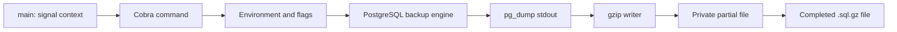

# Architecture

Copyright (c) 2026 Nardeo.

## Current system

Nardeo Backup is a single-process Go CLI. It invokes the installed PostgreSQL client rather than implementing the dump protocol itself. There is no application server, persistent metadata store or background worker.

## Boundaries

| Package | Responsibility |
| --- | --- |
| `cmd/nardeo-backup` | Process signals, Cobra command construction, command orchestration and exit status |
| `internal/config` | Environment defaults, flag binding, validation and password separation from PostgreSQL URIs |
| `internal/backup` | Client discovery, subprocess environment, streaming compression, diagnostics and output lifecycle |
| `internal/ui` | Branded help output, terminal color handling and `slog` logger construction |

Keep command parsing in the CLI and connection interpretation in configuration. The backup engine consumes `config.Config` and a context; it does not depend on Cobra.

## Configuration flow

`FromEnv` loads defaults and environment values when a command is constructed. Cobra binds flags to that configuration; explicit flags override the corresponding environment values. Help is available without a valid database connection, and a password-bearing environment URL is not rendered as a flag default.

Without a URL, the engine supplies the configured `PGHOST`, `PGPORT`, `PGUSER`, `PGPASSWORD` and `PGDATABASE` to the child. In URL mode it clears inherited connection fields, separates URI passwords into the child environment, and passes the remaining URI as `--dbname`. Other libpq environment settings, such as TLS options and `PGPASSFILE`, remain available.

PostgreSQL URIs have semantics that differ from HTML form query strings and generic URL host parsing. The parser preserves raw host syntax and non-password query fields while percent-decoding credentials. See the configuration and subprocess regression tests before modifying this path.

## Backup lifecycle

1. Validate configuration and cancellation, then find `pg_dump` in `PATH`.
2. Create the output directory when needed, with mode `0700` on Unix systems.
3. Create a unique timestamped temporary file with mode `0600` and suffix `.sql.gz.partial`.
4. Run `pg_dump --format=plain --no-password` through `exec.CommandContext`. Stream stdout directly into a gzip writer attached to the file. Capture a bounded stderr diagnostic buffer.
5. On success, close the gzip stream, synchronize and close the file, and check cancellation again.
6. Publish the completed file using a hard link to its final `.sql.gz` name. This fails rather than replacing an existing path. Remove the temporary name during cleanup.
7. Return the final path and log completion. On errors, return context and redact known credential values from captured diagnostics.

This design bounds memory use independently of database size. Publication requires hard-link support in the destination filesystem. Normal error and cancellation cleanup removes partial files; forced termination can leave them behind. Files are synchronized before publication; the current implementation does not promise directory synchronization or complete power-loss durability.

## Output and security

Root and help commands print the banner and usage to stdout. Backup status logs and errors go to stderr; raw database contents go only to the output file. Command logging uses `slog`; the engine currently sends successful-run client warnings through the default `slog` logger.

Gzip does not encrypt data. The database password remains available in the child environment, and a caller-provided `--db-url` can be visible in shell history or the parent process arguments. See [SECURITY.md](../SECURITY.md) for operational guidance and private reporting.

## Validation boundaries

Unit and subprocess tests exercise configuration, help, streaming, permissions, cancellation, errors and credential handling without a live database. An actual dump-and-restore check against a disposable PostgreSQL instance verifies the client and SQL integration when subprocess behavior changes. CI checks Go 1.22 and the current stable release; security workflows run vulnerability and static analysis checks.

The existing design rationale is recorded in [Decision 0001](decisions/0001-streaming-postgresql-backups.md). New capabilities should extend these boundaries only after their requirements are recorded.
